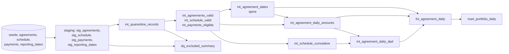

# Credit Portfolio Mart (Snowflake + dbt Core)

A tested, documented dbt project that turns four CSV extracts (agreements, installment schedule, payments, reporting dates) into a daily agreement fact and a portfolio mart. Task statement: [docs/TASK.md](docs/TASK.md). Design choices and the architecture note on ownership and certification: [DECISIONS.md](DECISIONS.md).

## Outputs

| Model | Grain | Purpose |
|---|---|---|
| `fct_agreement_daily` | agreement x reporting date (2026-01-01 .. 2026-06-30) | cumulative position per agreement: `total_due`, `total_paid`, `total_scheduled`, `arrears_amount`, `remaining_scheduled_amount`, `credit_balance`, `dpd`, `dpd7_flag`, `dpd30_flag` |
| `mart_portfolio_daily` | date x country x product x currency | agreement count, amounts, DPD 7+/30+ counts and rates (denominator: all agreements present that day) |
| `dq_excluded_summary` | source table x reason x currency | counts and amounts excluded from the metrics |
| `int_quarantine_records` | rejected or flagged staging row | queryable list of invalid rows with a reason |

Generated sample output (exported from the built tables) is in [sample_output/](sample_output/).

## Lineage



The interactive lineage graph, model and column documentation are generated by `dbt docs generate` (see below).

## Versions and execution status

| Component | Version |
|---|---|
| Python | 3.11.1 |
| dbt-core | 1.12.6 |
| dbt-snowflake | 1.12.4 |
| snowflake-connector-python (installed with dbt-snowflake) | 4.8.0 |
| uv (environment tool) | 0.11.6 |

Pinned in [requirements.txt](requirements.txt) (`dbt-core==1.12.6`, `dbt-snowflake==1.12.4`).

**Execution was performed** against a Snowflake trial account (macOS, 2026-10-28): `dbt debug`, `dbt seed`, `dbt build` and `dbt docs generate` ran successfully. The last `dbt build` finished with `PASS=179 WARN=0 ERROR=0`: 4 seeds, 15 models (12 views, 3 tables), 144 data tests (12 of them singular SQL tests in `tests/`) and 16 unit tests. No other adapter was used. No credentials or account identifiers are stored in the repository.

## Repository layout

```
models/staging/        typed, deduplicated sources + is_conflicting_version flag
models/intermediate/   quarantine, valid/eligible rows, spine, daily amounts, cumulative schedule, DPD
models/marts/          fct_agreement_daily, mart_portfolio_daily, dq_excluded_summary
macros/clean_text.sql  trim / uppercase / empty-to-NULL
seeds/                 the four CSVs (loaded as text) + their documentation
tests/                 singular tests (reconciliation, invariants, grain, precision)
models/**/unit_tests.yml   dbt unit tests with mocked inputs
setup/snowflake_setup.sql  one-off roles, warehouse, database, service user, read-only role
docs/                  task statement and data dictionary
sample_output/         exported results of the last run
```

## Run instructions

### 1. One-off Snowflake setup

Generate an RSA key pair outside the repository (commands are at the top of [setup/snowflake_setup.sql](setup/snowflake_setup.sql)), put the public key in the script, and run it in a worksheet as `ACCOUNTADMIN`. It creates the role `DBT_ROLE`, the warehouse `DBT_WH` (XSMALL, auto-suspend 60 s), the database `AE_TASK`, the schema `DBT_DEV`, the service user `DBT_SERVICE` (key-pair authentication, no password) and the read-only role `DBT_READER`.

### 2. Local environment

```bash
uv venv --python 3.11
source .venv/bin/activate
uv pip install -r requirements.txt
cp .env.example .env              # fill in account, user, key path (git-ignored)
cp profiles.yml.example profiles.yml
set -a; source .env; set +a       # load variables into the shell
```

`.env`, `profiles.yml` and `*.p8` / `*.pem` / `*.pub` are git-ignored; the profile reads everything from environment variables.

### 3. Build

```bash
dbt debug            # connection check
dbt seed             # load the four CSVs as text
dbt build            # seeds, models, data tests and unit tests, in dependency order
dbt docs generate    # model/column docs and lineage
dbt docs serve       # open the documentation site locally
```

Useful selections:

```bash
dbt test --select "test_type:unit"        # only the unit tests
dbt test --select "test_type:singular"    # only the singular tests
dbt build --select +mart_portfolio_daily  # the mart and everything it depends on
```

Because unit tests run before the model they test, a logic error stops the build before the table is replaced.

## Tests

| Kind | What it covers |
|---|---|
| Keys, not null | `unique` / `not_null` on every business key and on the grain keys of the spine, fact and mart |
| Relationships | installments, payments, spine and fact point to valid agreements; fact and mart dates exist in `reporting_dates` |
| Accepted values | country, product, currency, payment status, quarantine reasons, boolean flags |
| Precision | money columns of the marts must be `NUMBER(18,2)` in the warehouse |
| Reconciliation | eligible + excluded payments equal staging; last-date totals equal the sources; mart equals fact; fact has exactly the rows of the spine |
| Invariants | amounts never negative; cumulative amounts never decrease; `credit_balance - remaining_scheduled = total_paid - total_scheduled`; DPD flags follow DPD; DPD > 0 only with arrears |
| Unit tests (mocked inputs) | duplicates and conflicts, FIFO allocation and the 0.01 tolerance, DPD boundaries, overpayment, rate rounding, rejection rules, no fan-out |

## Conventions

- Rejection and exclusion reasons are UPPERCASE (`ORPHAN_PAYMENT`, `STATUS_REVERSED` ...). The `dq_` prefix marks data-quality models.
- Leading commas, import CTEs for every `ref()`, and `{{ref('model')}}` without inner spaces.
- Money is fixed-point `NUMBER(18,2)` throughout; no FX is applied and currencies are never summed together.

## Known limitations

See "Unfinished work and known limitations" in [DECISIONS.md](DECISIONS.md): no CI, no production schema override, no incremental models, and the mart is a certification *candidate*, not a certified dataset.
